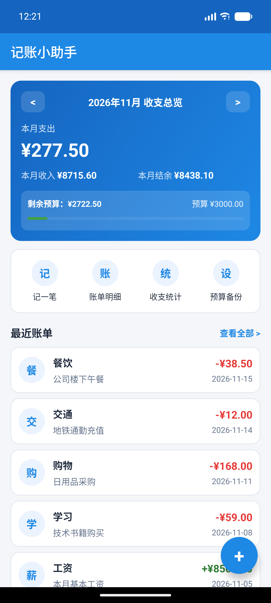
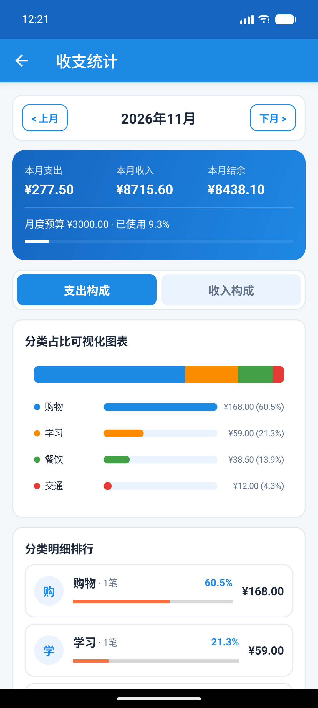
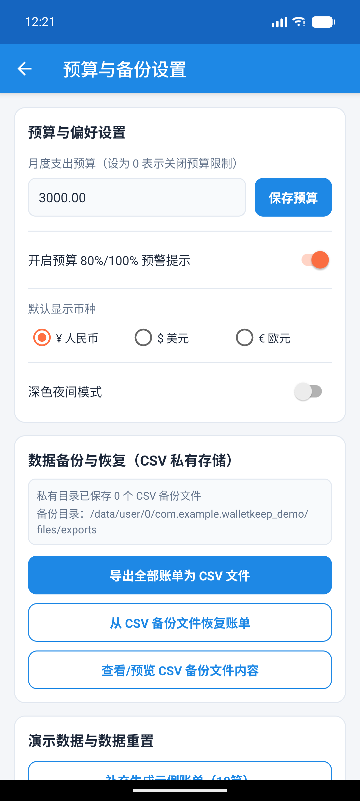

# 记账小助手 (WalletKeep)

一款完全离线的 Android 个人收支记账应用，用于演示 Android 三类本地数据持久化技术：**SQLite 关系型数据库**、**应用私有目录文件存储** 与 **SharedPreferences 简单存储**。

> 原课程设计规格与实施计划保留在 [`docs/superpowers/`](docs/superpowers/)，构建配置已按当前开发机环境升级（见[构建说明](#构建说明)）。

## 功能预览

| 首页看板 | 收支统计 | 预算与备份 |
|---|---|---|
|  |  |  |

## 功能特性

- **首页看板**：月度支出 / 收入 / 结余、预算进度条（正常 / 80% 预警 / 超支三态）、最近 15 笔账单、快捷入口。
- **记一笔**：支出 / 收入切换、分类网格选择、金额校验、日期选择、备注、票据图片附件（私有目录存储、缩略图、大图预览）。
- **自定义分类**：新增自定义分类，长按删除（系统默认分类与已被账单引用的分类受保护）。
- **账单明细**：备注 / 分类关键词实时搜索，月份 / 收支类型 / 分类三维筛选，筛选结果汇总，点击编辑、长按删除。
- **收支统计**：按月切换、支出 / 收入构成切换、预算使用率、自定义 `Canvas` 图表（100% 堆叠条 + 横向对比条）、分类排行。
- **数据备份**：导出全部账单为 CSV（同时快照票据图片）、选择备份恢复（覆盖 / 增量去重两种模式）、CSV 内容预览。
- **偏好设置**：月度预算、超支预警开关、币种（¥ / $ / €）、深色夜间模式。
- **首次启动引导**：可一键生成 10 笔演示账单，快速体验统计与导出功能。

## 技术栈

| 项 | 版本 / 说明 |
|---|---|
| 语言 | Java 11（源码兼容旧 Android API） |
| UI | 传统 Android XML View：`ListView` / `GridView` / `ScrollView` + `BaseAdapter` + 自定义 `Canvas` View |
| 构建 | Gradle **9.5.0**（Wrapper）+ Android Gradle Plugin **9.3.0** |
| JDK | **21**（AGP 9 要求 JDK 17+） |
| SDK | compileSdk **37** / targetSdk **34** / minSdk **24** |
| 依赖 | `androidx.appcompat:1.6.1`、`androidx.constraintlayout:2.1.4`、JUnit `4.13.2`、Espresso `3.5.1` |
| 主题 | `Theme.AppCompat.DayNight.DarkActionBar`，light / dark 两套配色 |

无网络库、无运行时存储权限，所有数据保存在应用私有目录。

## 项目结构

```text
app/src/main/java/com/example/walletkeep_demo/
├── model/          Category / Bill / CategoryStat 实体
├── db/             AccountBookDbHelper / CategoryDao / BillDao
├── storage/        CsvCodec / FileStorageManager / PrefsManager
├── ui/adapter/     BillListAdapter / CategoryGridAdapter / CategoryStatAdapter
├── ui/view/        CategoryChartView（自定义 2D 图表）
├── util/           DateAmountUtils（日期 / 金额 / 预算计算）、UiUtils（dp 换算、列表测高、进度条配色、格式化）
├── MainActivity              首页看板
├── AddEditBillActivity       记一笔 / 编辑 / 票据附件 / 分类管理
├── BillListActivity          明细筛选与搜索
├── StatsActivity             月度统计与图表
├── SettingsActivity          预算、备份恢复与系统设置
└── WalletKeepApp             Application 入口（应用主题）
```

## 本地持久化设计

### 1. SQLite（`account_book.db`，Version 1）

```sql
CREATE TABLE category (
    id INTEGER PRIMARY KEY AUTOINCREMENT,
    name TEXT NOT NULL,
    type INTEGER NOT NULL,        -- 0 支出, 1 收入
    icon TEXT,
    is_default INTEGER DEFAULT 0  -- 1 系统预置, 0 用户自定义
);

CREATE TABLE bill (
    id INTEGER PRIMARY KEY AUTOINCREMENT,
    amount_cents INTEGER NOT NULL, -- 金额，单位：分
    type INTEGER NOT NULL,
    category_id INTEGER NOT NULL,
    note TEXT,
    bill_date TEXT NOT NULL,      -- yyyy-MM-dd
    receipt_path TEXT,            -- 私有目录图片路径
    created_at TEXT NOT NULL,
    FOREIGN KEY(category_id) REFERENCES category(id)
);
```

- 首次建库自动预置 8 个支出分类与 6 个收入分类。
- 开启外键约束；导入 CSV 使用数据库事务，失败自动回滚。
- 支持多条件筛选、按月聚合、按分类分组统计占比。
- 金额以整数“分”存储，避免浮点累计误差；数据库版本为 2，v1 → v2 升级时自动把旧的 `amount` 浮点列迁移为 `amount_cents`，保留全部历史数据。
- 首页、账单明细、统计页的数据库查询在后台线程执行，结果通过主线程回调刷新 UI。

### 2. 文件存储（`context.getFilesDir()`）

- `files/exports/bill_backup_<时间戳>.csv`：CSV 账单备份，遵循 RFC 4180 转义。
- `files/exports/receipts_<时间戳>/`：导出时同步快照的票据图片。
- `files/receipts/IMG_<时间戳>.jpg`：记账时选择的票据图片。
- CSV 导入支持覆盖恢复与增量去重追加，可自动按文件名还原丢失的票据图片。

### 3. SharedPreferences（`app_settings`）

| Key | 类型 | 默认值 | 说明 |
|---|---|---|---|
| `monthly_budget_cents` | `long` | `300000` | 月度预算（以“分”存储避免浮点误差） |
| `default_currency` | `String` | `¥` | 默认币种符号 |
| `theme_mode` | `String` | `light` | `light` / `dark` |
| `reminder_enabled` | `boolean` | `true` | 预算 80% / 100% 预警 |
| `first_launch` | `boolean` | `true` | 首次启动引导标记 |

## 快速开始

### 环境要求

- Windows / macOS / Linux
- JDK 17 及以上（本机验证使用 **JDK 21**）
- Android SDK：platform **android-37**、build-tools **36.0.0**
- 任意 Android 7.0+（API 24）设备或模拟器

### Android Studio

1. 用 Android Studio 打开项目根目录并等待 Gradle Sync。
2. 确认 `local.properties` 中的 `sdk.dir` 指向本机 SDK（Android Studio 会自动生成）。
3. 选择设备 / 模拟器，点击 Run。

### 命令行构建

```powershell
# PowerShell（JDK 路径按本机修改）
$env:JAVA_HOME="C:\Program Files\Java\jdk-21"
cd WalletKeep_demo

# 构建 Debug APK
.\gradlew.bat assembleDebug
```

APK 输出：`app/build/outputs/apk/debug/app-debug.apk`

### 安装并启动

```powershell
adb install -r app\build\outputs\apk\debug\app-debug.apk
adb shell am start -n com.example.walletkeep_demo/.MainActivity
```

首次启动会询问是否生成演示数据，选择“生成演示数据”即可看到完整图表与列表效果。

### Claude Code 项目技能

本项目附带 [`.claude/skills/run-walletkeep/SKILL.md`](.claude/skills/run-walletkeep/SKILL.md)，记录了经过验证的构建、模拟器启动、安装、交互验证与常见报错处理流程。在 Claude Code 中打开项目后直接要求“运行这个项目”即可复用。

## 运行测试

```powershell
# 纯 JVM 单元测试（CSV 编解码、日期金额、预算精度）
.\gradlew.bat testDebugUnitTest

# 设备端隔离回归测试（需要已连接的模拟器 / 真机）
.\gradlew.bat connectedDebugAndroidTest
```

当前单元测试共 14 个用例，覆盖 CSV 转义 / 解析异常、月份滚动、金额校验、预算 80% / 100% 边界与浮点精度。设备端另有 6 个隔离回归测试，覆盖 v1 → v2 金额迁移、CSV 覆盖恢复保护、增量去重与票据还原。

## 使用说明

1. **记一笔**：首页右下角 `+` 或“记一笔”，选择支出 / 收入与分类，输入金额（必填且 > 0），可修改日期、填写备注、选择票据图片。
2. **自定义分类**：记账页点击“+ 新增分类”；长按自定义分类可删除（有账单引用时会拒绝）。
3. **查账单**：首页“账单明细”或“查看全部”，支持关键词搜索与月份 / 类型 / 分类组合筛选。
4. **看统计**：首页“收支统计”，切换月份与支出 / 收入构成，查看图表与分类排行。
5. **备份恢复**：设置页“导出全部账单为 CSV 文件”，之后可“从 CSV 备份文件恢复账单”，支持覆盖或增量去重；也可预览 CSV 原文。
6. **偏好设置**：设置页可修改月度预算、预警开关、币种与深色模式。

### 数据存放位置（应用私有目录）

```text
/data/user/0/com.example.walletkeep_demo/
├── databases/account_book.db
├── files/exports/            # CSV 备份与票据快照
├── files/receipts/           # 票据图片
└── shared_prefs/app_settings.xml
```

无需存储权限，卸载应用即清除全部数据。

## 构建说明

本项目最初的课程设计要求为 AGP 3.6.3 + Gradle 5.6.4 + JDK 8 + compileSdk 29。为适配当前开发机（JDK 21、Android SDK 37）并避免下载已淘汰的旧工具链，构建配置已升级：

| 配置 | 原值 | 当前值 |
|---|---|---|
| Gradle | 5.6.4 | **9.5.0** |
| AGP | 3.6.3 | **9.3.0** |
| compileSdk | 29 | **37** |
| minSdk | 17 | **24** |
| targetSdk | 29 | **34** |
| appcompat | 1.0.2 | **1.6.1** |

业务代码保持不变，仅做了 AGP 8+ 必需的配置调整：

- 在 `app/build.gradle` 中使用 `namespace`，并从 `AndroidManifest.xml` 移除 `package` 属性；
- 为带 launcher `intent-filter` 的 `MainActivity` 显式声明 `android:exported="true"`；
- 依赖仓库改为阿里云镜像，Gradle Wrapper 发行版改为腾讯云镜像，便于国内网络构建。

## 常见问题

| 问题 | 处理 |
|---|---|
| Gradle Wrapper 下载超时 | 已将 `distributionUrl` 指向腾讯云镜像；如仍失败，检查网络或手动下载后放入 `~/.gradle/wrapper/dists/` |
| 依赖解析失败 / jcenter 报错 | 已移除 `jcenter()`，使用 `settings.gradle` 中的阿里云镜像 + Google Maven + Maven Central |
| `Unsupported class file major version` | Gradle 正在使用过旧的 JDK，设置 `JAVA_HOME` 为 JDK 17+（本机为 jdk-21） |
| `local.properties` 缺失 | 在项目根目录创建并写入 `sdk.dir=...`，或直接用 Android Studio 打开让其自动生成 |
| Git Bash 下 `adb screencap` 路径被改写 | 命令前加 `MSYS_NO_PATHCONV=1` |
| 模拟器 API 37 能否运行 | 可以，项目 minSdk 24 / targetSdk 34，已在 Pixel_8（API 37）验证 |

## License

本项目为课程设计演示项目，仅用于学习与交流。
